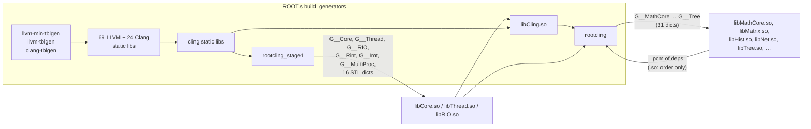

# CERN ROOT as a RepliBuild target: reconnaissance (Linux)

Measured 2026-10-30 on Linux. Nothing in `src/` or `test/` changed. The
question is how ROOT fits RepliBuild's graph mode: RepliBuild owns every compile
and link, takes the build graph from the project's own CMake through the File
API (configure only), and hands code generators to the project's build system.

Every number below was measured on the machine described in §1, unless it is
marked as read from source. File paths inside ROOT are relative to its source
tree at the tag below; `BLD/` is the build tree.

- **ROOT** `v6-40-04`, commit `1211eda93010f26710eafd527d1e66921bffdf8e`
  (2026-08-27). root.cern's release list marks it `state: latest`; the only
  newer tag is `v6-42-00-rc1` (2026-10-29), a release candidate.
- **Build**: `-Dminimal=ON -Dfail-on-missing=OFF`, Ninja, clang 23.1.4,
  `CMAKE_BUILD_TYPE` left at ROOT's default (Release), C++17 (ROOT's default).

---

## 0. Answers first

**Measured** on 4 cores with Ninja: `--target rootcling` took **31.9 min**
and 1.02 GB of build tree. The full minimal build took **34.1 min** and
1.29 GB from scratch, or 2.8 min more after `rootcling`. ROOT's bundled LLVM
and Clang are 83% of the full build's edge time, and ROOT's own libraries 13%.
Everything was compiled by clang 23.1.4 and works: a `TH1D` filled, written to
a `TFile` and read back gave the right mean.

1. **Even `libCore.so` needs the whole bundled compiler first.** Core's
   dictionary `G__Core.cxx` is written by `rootcling_stage1`, an executable that
   statically links cling, 69 LLVM and 24 Clang static libraries. The target
   closure of `Core` in the File API reply has 282 targets, and 269 of them are
   LLVM, Clang or cling. No ROOT library can be built before ROOT's own LLVM 20,
   patched Clang and cling.
2. **Most of the compiles are the interpreter.** The full minimal build runs
   3,365 compiles: 1,717 bundled LLVM, 647 bundled Clang, 53 cling, 3
   CppInterOp, 945 ROOT (53 of them dictionaries). The `rootcling` target alone
   runs 2,717, of which 297 are ROOT sources.
3. **Every code generator is built from ROOT's sources.** `llvm-min-tblgen`,
   `llvm-tblgen`, `clang-tblgen` (bundled LLVM), `rootcling_stage1`,
   `rootcling`, and `root.exe`, which the default target runs to write
   `lib/modules.idx` and `tutorials/hsimple.root`. The only generators not
   built here are `python3`, `sh` and `cmake -E`.
4. **Dictionary generation is interleaved with the library graph.**
   `G__Hist.cxx` has `lib/libMathCore.so`, `lib/libMatrix.so`,
   `lib/libRIO.so`, `MathCore.pcm` and `Matrix.pcm` as explicit Ninja inputs.
   Under `strace`, rootcling reads the `.pcm` files and never opens the two
   `.so` files, so the libraries only set the order. The modules are real
   inputs, though: a library's dictionary can only be written after its
   dependencies' dictionaries. Generation is not one phase before the
   compiles.
5. **A system LLVM can stand in for the LLVM half only, and only LLVM 20.1.x.**
   `interpreter/CMakeLists.txt` refuses any other version (LLVM 19.1.1 measured:
   configure error), and Clang must be the bundled copy, which carries 45 ROOT
   patches on upstream 20.1.8. Ubuntu's LLVM 20.1.2 cuts the `rootcling`
   closure from 2,717 to 1,000 compiles. RepliBuild's own LLVM (21+, 22 and 23
   in CI) cannot fill either role.
6. **ROOT's own libraries are uniform.** 105 of the 141 C++ compile groups
   outside the bundled LLVM/Clang share one flag string. Libraries differ by
   include directories (16–34 each) and a handful of defines. The cling-facing
   code and the bundled LLVM carry their own flags (§3.3).
7. **Windows: MSVC only.** ROOT's CMake stops with a fatal error for any Windows
   compiler that is neither MSVC nor GCC. cling's Windows code looks up Visual
   Studio and the Windows SDK and sets MSVC compatibility. RepliBuild's Windows
   target, `x86_64-w64-windows-gnu`, is not one ROOT builds for (§5).

---

## 1. Environment

| | |
|---|---|
| Host | Ubuntu 24.04.5 LTS, kernel 6.18, 4 cores (Intel Xeon @ 2.10 GHz), 15 GB RAM, no swap, ~28 GB writable disk |
| Compiler | clang 23.1.4 (`LLVM-23.1.4-Linux-X64.tar.xz`, the llvm-project GitHub release) |
| CMake / Ninja | 3.28.3 / 1.11.1 (Ubuntu packages) |
| GCC (libstdc++ used by clang) | 13.3.0 |
| binutils (`ld`) | 2.42 |
| Python | 3.13.17 on `PATH` (Ubuntu's `python3` package is 3.12.3) |

**Deviation from the plan: no apt.llvm.org.** The environment's network
policy refused `apt.llvm.org`, `root.cern` and `lcgpackages.web.cern.ch`
(proxy 403). The compiler is the official LLVM 23.1.4 release tarball instead,
the same major as `tier2-linux.yml`'s LLVM 23 cell; only `clang`, `lld`, a few
llvm tools and `lib/clang/23` were extracted. ROOT's install docs were read
from their source, [root-project/web](https://github.com/root-project/web)
at `d788721` (2026-10-29), the Jekyll source root.cern is built from.

### 1.1 ROOT's Ubuntu prerequisites, and what was really required

ROOT's [dependencies page](https://root.cern/install/dependencies/) (source:
`getroot/dependencies.md`) lists for Ubuntu:

```bash
sudo apt install binutils cmake dpkg-dev g++ gcc libssl-dev git libx11-dev \
libxext-dev libxft-dev libxpm-dev python3 libtbb-dev libvdt-dev libgif-dev
```

Installed versions: libssl-dev 3.0.13, libx11-dev 1.8.7, libxext-dev 1.3.4,
libxft-dev 2.3.6, libxpm-dev 3.5.17, libtbb-dev 2021.11.0, libvdt-dev 0.4.4,
libgif-dev 5.2.2, dpkg-dev 1.22.6, git 2.43.0.

**That list is not enough.** With only those packages, configure fails:

```
CMake Error at cmake/modules/SearchInstalledSoftware.cmake:95 (message):
  The required package LZ4 was not found.  Please install it in the system
  (preferred), set the corresponding CMake search variable, or opt in to
  downloading it using '-Dbuiltin_lz4=ON'.
CMake Error at cmake/modules/SearchInstalledSoftware.cmake:95 (message):
  The required package ZSTD was not found.  …
```

`ROOT_FIND_REQUIRED_DEP` treats LZ4, LZMA, ZLIB and ZSTD as required and
ignores `fail-on-missing`. The packages are on the page's *optional* list. I
installed `liblz4-dev` 1.9.4, `libzstd-dev` 1.5.5 and `libxxhash-dev` 0.8.2
from that list. The image already had `zlib1g-dev`, `liblzma-dev`,
`libpcre2-dev` and `libfreetype-dev`, which configure also picked up. Without
`libxxhash-dev`, ROOT switches to its in-tree xxHash; without nlohmann-json it
switches to its in-tree copy (`builtin_nlohmannjson`, a header copy only),
which happened here.

The `builtin_*` alternatives matter for graph mode. Of the 15 directories in
`builtins/` that have a `CMakeLists.txt`, only `nlohmann` and `xxhash` are
in-tree CMake targets. The other 13 are
`ExternalProject_Add`, a nested CMake build: 12 download a tarball from
`lcgpackages.web.cern.ch`, and pcre unpacks one that ships in the tree. The
File API cannot see inside an ExternalProject, so every dependency should come
from the system.

---

## 2. Configure

```bash
mkdir -p BLD/.cmake/api/v1/query
touch BLD/.cmake/api/v1/query/{codemodel-v2,cache-v2,toolchains-v1,cmakeFiles-v1}
cmake -G Ninja -S root-src -B BLD -Dminimal=ON -Dfail-on-missing=OFF \
  -DCMAKE_C_COMPILER=/opt/llvm23/bin/clang -DCMAKE_CXX_COMPILER=/opt/llvm23/bin/clang++ \
  -DCMAKE_EXPORT_COMPILE_COMMANDS=ON
```

Configure took 13.5 s of wall time and wrote 1,432 reply files.

```
Enabled support for:  builtin_clang builtin_cling builtin_llvm builtin_nlohmannjson runtime_cxxmodules shared thisroot_scripts
ROOT Architecture: linuxx8664gcc    (even with clang)
C++ standard:      17
Cling will look for C++ headers in '/usr/lib/gcc/x86_64-linux-gnu/13/…/include/c++/13:…' at runtime.
And if not found, will invoke: '/opt/llvm23/bin/clang++ ' for them.
```

`minimal` turns every option off except
`builtin_llvm|builtin_clang|builtin_cling|shared|runtime_cxxmodules|thisroot_scripts`
(`cmake/modules/RootBuildOptions.cmake`). The interpreter is therefore always
part of a minimal build, and so are the C++ modules (`.pcm` files).

---

## 3. The File API reply

### 3.1 Targets by type

1,023 targets in 404 directories and two CMake projects (`ROOT`, `LLVM`).

| Area (source dir) | EXECUTABLE | SHARED | MODULE | STATIC | OBJECT | INTERFACE | UTILITY | Total |
|---|---:|---:|---:|---:|---:|---:|---:|---:|
| Bundled LLVM (`interpreter/llvm-project/llvm`) | 89 | 2 | 1 | 102 | 3 | 0 | 285 | 482 |
| Bundled Clang (`interpreter/llvm-project/clang`) | 14 | 1 | 6 | 40 | 40 | 25 | 256 | 382 |
| cling (`interpreter/cling`) | 0 | 0 | 0 | 3 | 3 | 0 | 4 | 10 |
| CppInterOp + `interpreter/` | 0 | 0 | 0 | 1 | 0 | 0 | 1 | 2 |
| ROOT | 16 | 53 | 0 | 2 | 60 | 0 | 15 | 146 |
| `builtins/nlohmann` | 0 | 0 | 0 | 0 | 0 | 0 | 1 | 1 |
| **Total** | **119** | **56** | **7** | **148** | **106** | **25** | **562** | **1,023** |

`llvm-project` is added with `EXCLUDE_FROM_ALL`, so most of its 864 targets are
never built. What is built is whatever libCling and the tablegen tools pull in:

| | `--target rootcling` | full minimal (`all`) |
|---|---:|---:|
| Ninja edges | 3,274 | 4,164 |
| C/C++ compiles | 2,717 | 3,365 |
| — bundled LLVM | 1,717 | 1,717 |
| — bundled Clang | 647 | 647 |
| — cling | 53 | 53 |
| — CppInterOp | 3 | 3 |
| — ROOT (incl. dictionaries) | 297 | 945 |
| — of which `G__*.cxx` dictionaries | 5 | 53 |
| Links (`.so` + executables) | 11 | 72 |
| Static archives | 98 | 100 |

(Counted from `ninja -t commands <target>`; compiles are lines with `-c`.)

ROOT's 146 targets, by role:

- **53 shared libraries.** 37 are named libraries (Core, Thread, RIO,
  MathCore, Matrix, Hist, Tree, Net, …) and 16 are dictionary-only STL
  libraries (`libvectorDict.so`, `libmapDict.so`, …, built from
  `core/clingutils`).
- **16 executables.** `rootcling`, `rootcling_stage1`, `root`, `root.exe`,
  `rootn.exe`, `roots.exe`, `rootnb.exe`, `hadd`, `genreflex`, `rootcint`,
  `rootls`, `rootcp`, `rootmkdir`, `rootrm`, `rootreadspeed`, `rmkdepend`.
- **60 object libraries.** 53 are `G__<Lib>`, one per dictionary, so each
  dictionary compiles in its own target and is linked into its library. The
  other 7 are `Clib`, `ClingUtils`, `Dictgen`, `Foundation_Stage1`,
  `MetaCling`, `RootPcmObjs` and `ReadSpeed`.
- **2 static libraries** (`mathtext`, `rsa`) and **15 utilities**:
  `move_headers` copies headers into `BLD/include` (1,121 files after the
  build), plus `rconfigure`,
  `LLVMRES`, `modules_idx`, `hsimple` and man pages.

`Core` lists 302 sources, of which 185 compile directly. Its subdirectories add
them with `target_sources`, so there is no per-subdirectory target. `Cling`
(`libCling.so`) compiles nothing itself: it is assembled from `MetaCling`,
`ClingUtils`, `Dictgen`, the three cling static libraries, CppInterOp and the
LLVM/Clang archives.

### 3.2 Library dependency graph

From each target's `link.commandFragments` in the reply (role `libraries`).
External libraries are in italics. Every ROOT library below also links
`libCore.so`, so Core is left out of the right-hand column.

| Library | Links against |
|---|---|
| Core | *libdl, libpcre2-8, libz, liblzma, libxxhash.a, liblz4, libzstd* |
| Thread | (Core only) |
| RIO | Thread, *libdl* (+ object lib `RootPcmObjs`) |
| MathCore | (Core only) |
| Matrix | MathCore |
| Net | RIO, Thread |
| Hist | Matrix, RIO, MathCore, Thread |
| Tree | Net, RIO, MathCore, Thread |
| MultiProc | Net, RIO, Thread, *libdl* |
| Imt | MultiProc, Net, RIO, Thread |
| GenVector | MathCore |
| Physics | Matrix, GenVector, MathCore |
| Graf | Hist, Matrix, MathCore, RIO, Thread, *libfreetype, libz*, `libmathtext.a` |
| Gpad | Graf, Hist, Matrix, MathCore, RIO, Thread |
| TreePlayer | Graf3d, Tree, MultiProc, Gpad, Graf, Hist, Matrix, MathCore, Net, RIO, Thread |
| ROOTNTuple | Imt, ROOTVecOps, MultiProc, Net, RIO, Thread, *libxxhash.a* |
| Rint | (Core only) |
| New | (Core only) |
| **Cling** (`libCling.so`) | RIO (→ Thread, Core); static `libclingInterpreter.a`, `libclingMetaProcessor.a`, `libclingUtils.a`, `libclangCppInterOp.a`, 69 `libLLVM*.a`, 24 `libclang*.a`; `-Wl,-Bsymbolic -Wl,--version-script=core/metacling/src/libCling.script -Wl,--gc-sections` |
| `rootcling` (exe) | Cling, Rint, RIO, Thread, Core |
| `rootcling_stage1` (exe) | object libs `Clib`, `ClingUtils`, `Dictgen`, `Foundation_Stage1`; the cling, LLVM and Clang archives. **Not** Core. |

Target-level dependencies (the reply's `dependencies`) add the build-order
edges that matter most. `Core` depends on the utility `CLING` (all of cling,
LLVM and Clang) and on `G__Core`, whose only source is generated by
`rootcling_stage1`. Each library depends on its own `G__<Lib>`.



The cycle is broken by order, not by structure. libCore does not link
libCling: TROOT `dlopen`s it at start-up (`core/base/src/TROOT.cxx`,
`RTLD_LAZY|RTLD_LOCAL`). libCling links libRIO, libThread and libCore, and
`rootcling` links libCling.

### 3.3 Compile flags and defines that differ

**ROOT's own libraries share one flag string.** 105 of the 141 C++ compile
groups outside the bundled LLVM/Clang (ROOT, cling, CppInterOp) use exactly:

```
-Wc++11-narrowing -Wsign-compare -Wsometimes-uninitialized -Wconditional-uninitialized
-Wheader-guard -Warray-bounds -Wcomment -Wtautological-compare -Wstrncat-size
-Wloop-analysis -Wbool-conversion -pipe -Wall -W -Woverloaded-virtual -fsigned-char
-fsized-deallocation -pthread -O3 -DNDEBUG -std=c++17 -fPIC
```

Deltas from that baseline:

| Where | Difference |
|---|---|
| Every library | include directories: 16–34 per target, all in the source tree (`<module>/inc`, `core/*/inc`, `core/foundation/res`, `core/base/src`) plus `BLD/ginclude` |
| `G__*` dictionary objects | the library's includes **plus `BLD/include`**, the `move_headers` copy |
| Core (179 + 1 C++, 5 C files) | `-DLIB_CORE_NAME=libCore.so -DINSTALL_LIB_TO_INCLUDE="../include"`; defines `R__ARC4_STDLIB _COMPLEX_H __COMPLEX_H__ __STDC_NO_COMPLEX__ __CLANG_STDATOMIC_H`; one file adds `USE_PCRE2` |
| RIO | `NLOHMANN_JSON_PROVIDES_FWD_HPP`; one file adds `-I core/foundation/res` |
| Minuit2, G__Minuit2 | `USE_ROOT_ERROR` |
| ROOTVecOps, G__ROOTVecOps | `-fno-finite-math-only` |
| Executables | no `-fPIC` |
| C sources (Clib, Core, Graf3d) | `-pipe -Wall -W -pthread -O3 -DNDEBUG -fPIC` and the target's defines |
| Interpreter-facing ROOT code: `MetaCling`, `ClingUtils`, `Dictgen`, `Foundation_Stage1`, `rootcling`, `rootcint`, `genreflex` | LLVM's `-D_GNU_SOURCE -D__STDC_CONSTANT_MACROS -D__STDC_FORMAT_MACROS -D__STDC_LIMIT_MACROS`, `-fno-strict-aliasing -Wwrite-strings -Wno-shadow -Wno-unused-parameter` (`CLING_CXXFLAGS`), `-fvisibility-inlines-hidden`, `-Wno-error` on most, the LLVM/Clang include dirs (source and build trees). 3 files in MetaCling, 3 in Dictgen and `rootcling_stage1`'s main add `-fno-rtti` |
| cling (`obj.cling*`, 53 files) | the above plus `-fno-semantic-interposition -fno-rtti -fvisibility=hidden`, `CLING_VERSION=ROOT_1.4~dev`, `LLVM_BUILD_STATIC`; one file each re-enables `-fexceptions` and `-frtti` |
| Bundled LLVM/Clang | ROOT's warnings, then LLVM's own: `-fno-semantic-interposition -fvisibility=hidden -fvisibility-inlines-hidden -ffunction-sections -fdata-sections -fno-exceptions -funwind-tables -w -Werror=date-time -Werror=unguarded-availability-new`, C++17, Release (`LLVM_BUILD_TYPE`, independent of ROOT's build type). Clang adds `-fno-common -Wno-nested-anon-types` and `CLANG_EXPORTS` |

So graph mode needs per-target flags in two families, ROOT's and LLVM's.
Within ROOT's libraries the variation is include paths plus about six
defines, and the reply's per-target compile groups carry all of it.

### 3.4 Generated sources

From the reply's `isGenerated` flags, matched to the producing edges in
`build.ninja`.

**Compiled generated sources in ROOT's targets: 53, all dictionaries.** Each
`G__<Lib>` object library has exactly one: `G__<Lib>.cxx`. The other generated
entries in the reply are headers listed as sources (Core lists 16, `Cling` 31,
`rootcling_stage1` 33).

| Tool | Dictionaries | Other outputs |
|---|---:|---|
| `rootcling_stage1` | 22: Core, Thread, RIO, Rint, Imt, MultiProc, and the 16 STL dicts | 6 `.pcm`, 16 `.rootmap` |
| `rootcling` | 31: MathCore, Matrix, Hist, Net, Tree, GenVector, Physics, Minuit, Minuit2, Fumili, Foam, MLP, Quadp, Smatrix, Smatrix32, SPlot, ROOTVecOps, GenVector32, HistPainter, TreePlayer, ROOTNTuple, ROOTNTupleUtil, SQLIO, XMLIO, RootAuth, Gpad, Graf, Graf3d, Postscript, RCsg, EG | 29 `.pcm`, 2 `.rootmap` |

Each dictionary edge writes `G__<Lib>.cxx` and `lib/<Lib>.pcm` (or a rootmap),
a Clang 20 module file the interpreter reads at run time. Its explicit Ninja
inputs include the dependency libraries and their modules:

| Dictionary | Generator | `.so` inputs | `.pcm` inputs | Headers |
|---|---|---|---|---:|
| G__Core | `rootcling_stage1` | — | — | 205 |
| G__Thread | `rootcling_stage1` | Core | — | 20 |
| G__RIO | `rootcling_stage1` | Core, Thread | Core, Thread | 36 |
| G__MultiProc | `rootcling_stage1` | Core, **Net** | — | 9 |
| G__MathCore | `rootcling` | Core | Core | 89 |
| G__Matrix | `rootcling` | MathCore | MathCore | 48 |
| G__Hist | `rootcling` | MathCore, Matrix, RIO | MathCore, Matrix | 87 |
| G__Net | `rootcling` | RIO | RIO | 33 |
| G__Tree | `rootcling` | Net, RIO, MathCore | MathCore | 54 |

(`ninja -t query <out>`, explicit inputs only. Headers are counted once; each
edge lists every header twice.)

<details><summary>All 53 dictionaries</summary>

| Dictionary | Generator | `.so` inputs | `.pcm` inputs | Headers |
|---|---|---|---|---:|
| G__complexDict | `rootcling_stage1` | Core | — | 1 |
| G__Core | `rootcling_stage1` | — | — | 205 |
| G__dequeDict | `rootcling_stage1` | Core | — | 1 |
| G__forward_listDict | `rootcling_stage1` | Core | — | 1 |
| G__Imt | `rootcling_stage1` | Core, MultiProc | — | 2 |
| G__listDict | `rootcling_stage1` | Core | — | 1 |
| G__map2Dict | `rootcling_stage1` | Core | — | 1 |
| G__mapDict | `rootcling_stage1` | Core | — | 1 |
| G__multimap2Dict | `rootcling_stage1` | Core | — | 1 |
| G__multimapDict | `rootcling_stage1` | Core | — | 1 |
| G__MultiProc | `rootcling_stage1` | Core, Net | — | 9 |
| G__multisetDict | `rootcling_stage1` | Core | — | 1 |
| G__Rint | `rootcling_stage1` | Core | — | 3 |
| G__RIO | `rootcling_stage1` | Core, Thread | Core, Thread | 36 |
| G__setDict | `rootcling_stage1` | Core | — | 1 |
| G__Thread | `rootcling_stage1` | Core | — | 20 |
| G__unordered_mapDict | `rootcling_stage1` | Core | — | 1 |
| G__unordered_multimapDict | `rootcling_stage1` | Core | — | 1 |
| G__unordered_multisetDict | `rootcling_stage1` | Core | — | 1 |
| G__unordered_setDict | `rootcling_stage1` | Core | — | 1 |
| G__valarrayDict | `rootcling_stage1` | Core | — | 1 |
| G__vectorDict | `rootcling_stage1` | Core | — | 1 |
| G__EG | `rootcling` | Gpad, Graf, Graf3d, MathCore, Physics | Gpad, Graf, Graf3d, MathCore, Physics | 11 |
| G__Foam | `rootcling` | Hist, MathCore | MathCore | 7 |
| G__Fumili | `rootcling` | Graf, Hist, MathCore | MathCore | 3 |
| G__GenVector | `rootcling` | Core, MathCore | Core, MathCore | 111 |
| G__GenVector32 | `rootcling` | Core, MathCore | Core, MathCore | 6 |
| G__Gpad | `rootcling` | Graf, Hist | Hist | 23 |
| G__Graf | `rootcling` | Hist, Matrix, MathCore, RIO | Hist, Matrix, MathCore, RIO | 38 |
| G__Graf3d | `rootcling` | Gpad, Graf, Hist, MathCore | Gpad, Graf, Hist, MathCore | 34 |
| G__Hist | `rootcling` | MathCore, Matrix, RIO | MathCore, Matrix | 87 |
| G__HistPainter | `rootcling` | Gpad, Graf, Hist, MathCore, Matrix | Hist, MathCore, Matrix | 7 |
| G__MathCore | `rootcling` | Core | Core | 89 |
| G__Matrix | `rootcling` | MathCore | MathCore | 48 |
| G__Minuit | `rootcling` | Graf, Hist, Matrix, MathCore | Matrix, MathCore | 6 |
| G__Minuit2 | `rootcling` | MathCore, Hist | MathCore | 87 |
| G__MLP | `rootcling` | Hist, Matrix, Tree, Graf, Gpad, TreePlayer, MathCore | Matrix, MathCore | 5 |
| G__Net | `rootcling` | RIO | RIO | 33 |
| G__Physics | `rootcling` | Matrix, MathCore, GenVector | Matrix, MathCore | 11 |
| G__Postscript | `rootcling` | Graf | Graf | 6 |
| G__Quadp | `rootcling` | Matrix | Matrix | 15 |
| G__RCsg | `rootcling` | MathCore | MathCore | 2 |
| G__RootAuth | `rootcling` | Net, RIO | Net, RIO | 6 |
| G__ROOTNTuple | `rootcling` | Imt, RIO, ROOTVecOps | Imt, ROOTVecOps | 46 |
| G__ROOTNTupleUtil | `rootcling` | ROOTNTuple, Tree, Hist | ROOTNTuple, Tree, Hist | 4 |
| G__ROOTVecOps | `rootcling` | Core | Core | 2 |
| G__Smatrix | `rootcling` | Core, MathCore | Core, MathCore | 22 |
| G__Smatrix32 | `rootcling` | Core, MathCore | Core, MathCore | 5 |
| G__SPlot | `rootcling` | Matrix, Hist, Tree, TreePlayer, Graf3d, Graf, MathCore | Matrix, MathCore | 2 |
| G__SQLIO | `rootcling` | Net, RIO | RIO | 7 |
| G__Tree | `rootcling` | Net, RIO, MathCore | MathCore | 54 |
| G__TreePlayer | `rootcling` | Gpad, Graf, Graf3d, Hist, MultiProc, MathCore, RIO, Tree | Hist, MultiProc, MathCore, Tree | 34 |
| G__XMLIO | `rootcling` | RIO | RIO | 7 |

</details>

The stage split is not a phase split: `G__MultiProc` is a stage-1 dictionary
that waits for `libNet.so`, whose own dictionary comes from `rootcling`.

A dictionary command (`G__Hist`, header list cut):

```
cd BLD/hist/hist && cmake -E env ROOTIGNOREPREFIX=1 BLD/bin/rootcling -rootbuild -v2
  -f G__Hist.cxx -cxxmodule -s BLD/lib/libHist.so -m MathCore.pcm -m Matrix.pcm
  -excludePath <src> -excludePath BLD/ginclude -excludePath BLD/externals -excludePath BLD/builtins
  -writeEmptyRootPCM
  -compilerI/usr/include/c++/13 … -compilerI/opt/llvm23/lib/clang/23/include …
  -I BLD/include -I <src>/hist/hist/inc … -I BLD/ginclude …
  Foption.h HFitInterface.h TAxis.h … v5/TFormulaPrimitive.h -DR__DUMMY_CXX_STANDARD_17
```

`-s` names the library the dictionary will live in, and `-compilerI` passes
the **build compiler's** include paths, here clang 23's resource directory, to
the Clang 20 inside rootcling.

**Other generated files in ROOT's area:**

| File | Produced by | When |
|---|---|---|
| `BLD/ginclude/RConfigure.h`, `RConfigOptions.h` | `configure_file` (`cmake/modules/RootConfiguration.cmake`) | configure |
| `BLD/ginclude/compiledata.h` | `cmake/unix/compiledata.sh` (records the build compiler for ACLiC) | configure |
| `cling-compiledata.h` | `configure_file`, then `cmake -E copy_if_different` | configure + build |
| 4 × `BLD/ginclude/*CommandLineOptionsHelp.h` | `python3 cmake/scripts/argparse2help.py` | build |
| `cling/Interpreter/ClingOptions.inc` | bundled `llvm-tblgen` | build |
| `BLD/include`: 1,121 files (1,009 `.h`, 103 `.hxx`, 7 `.icc`, 1 `.hpp`, `ROOT.modulemap`) | `move_headers` (`cmake -E copy`, 1,120 outputs) | build |
| `lib/modules.idx`, `tutorials/hsimple.root` | the freshly built `bin/root.exe` | end of `all` |

**In the bundled LLVM/Clang:** 29 `llvm-min-tblgen`, 57 `llvm-tblgen` and 104
`clang-tblgen` edges write `.inc` files, and 9 Python edges write other
generated sources.

### 3.5 Generator tools and what they need

Target dependencies from the reply. The transitive closure counts all target
types, including utilities:

| Tool | Direct target deps | Closure |
|---|---|---|
| `llvm-min-tblgen` | `LLVMSupport`, `LLVMTableGen`, `LLVMDemangle`, `obj.LLVMTableGenBasic` | LLVM only |
| `llvm-tblgen` | the above + `LLVMCodeGenTypes`, `intrinsics_gen`, `obj.LLVMTableGenCommon` | LLVM only |
| `clang-tblgen` | `LLVMSupport`, `LLVMTableGen`, `LLVMDemangle`, `obj.clangSupport` | LLVM and `clangSupport` |
| `rootcling_stage1` | `Clib ClingUtils Dictgen Foundation_Stage1`, `clingInterpreter clingMetaProcessor clingUtils`, 69 `LLVM*`, 24 `clang*`, `move_headers` | 278 targets; executables in it: the 3 tblgens |
| `Cling` (`libCling.so`) | the above + `MetaCling`, `clangCppInterOp`, `Core`, `RIO`, `Thread`, `rootcling_stage1` | 290; executables: 3 tblgens, `rootcling_stage1` |
| `rootcling` | `Cling Core RIO Rint Thread complexDict move_headers` | 295; ROOT shared libs in it: Cling, Core, RIO, Rint, Thread, complexDict |
| `root.exe` | `Core Rint move_headers` | (Core's closure) |

**Every generator that writes a compiled source is built from ROOT's tree.**
Handing the generators to ROOT's build therefore means ROOT's build also
compiles and links what they link: the bundled LLVM/Clang/cling, plus
`libCore`, `libThread`, `libRIO`, `libRint` and `libcomplexDict`. That is the
`rootcling` target as measured in §4.

### 3.6 The bundled LLVM/Clang

- **Version.** `interpreter/llvm-project` is LLVM **20.1.8**
  (`cmake/Modules/LLVMVersion.cmake`). It is a copy of
  [root-project/llvm-project](https://github.com/root-project/llvm-project)
  at tag `ROOT-llvm20-20260616-01` (`llvm-project.tag`; ROOT's
  `llvm-diff.yml` CI diffs the two). That tag is 53 commits on top of
  `llvmorg-20.1.8`: 45 ROOT patches and 8 marked `UPSTREAM:` backports. The
  patches touch `clang/lib` (67 file changes), `clang/include` (28),
  `llvm/lib` (3) and `llvm/include` (2): Sema, Serialization, Parser,
  FileManager and module-index work for cling (incremental parsing,
  autoloading, decl unloading, PCM loading).
- **Always built?** In a minimal build, yes. `builtin_llvm`, `builtin_clang`
  and `builtin_cling` default ON, and `minimal` exempts them from switching
  everything off.
- **System LLVM (`builtin_llvm=OFF`).** Allowed, but only for LLVM 20.1.x:
  `interpreter/CMakeLists.txt` sets `ROOT_LLVM_VERSION_REQUIRED_MAJOR 20` and
  stops with `LLVM version … different from ROOT supported, please try
  20.1.x` otherwise. Measured with Ubuntu 24.04's packages (configure only,
  same options plus `-Dbuiltin_llvm=OFF -DLLVM_DIR=…`):

  | System LLVM | Configure | `rootcling` compiles | `all` compiles |
  |---|---|---:|---:|
  | none (bundled 20.1.8) | ok | 2,717 | 3,365 |
  | `llvm-20-dev` 20.1.2 | ok (also needs `libedit-dev`: Ubuntu's `LLVMExports.cmake` names `LibEdit::LibEdit`) | 1,000 | 1,648 |
  | `llvm-19-dev` 19.1.1 | `CMake Error at interpreter/CMakeLists.txt:327: LLVM version 19.1.1 different from ROOT supported, please try 20.1.x` | — | — |

  With a system LLVM 20 the bundled Clang (647 compiles), cling (53) and
  CppInterOp (3) are still built, and Clang reports the system LLVM's version
  (`Clang version: 20.1.2`). That configuration was not built here.
- **System Clang (`builtin_clang=OFF`).** CMake warns "Due to ROOT-specific
  patches you need a special version of clang. You cannot use vanilla clang."
  and `builtin_llvm=ON` with `builtin_clang=OFF` is a fatal error. A vanilla
  Clang 20 lacks the 45 patches, so Clang is effectively always built from
  ROOT's copy.
- **External cling (`builtin_cling=OFF`):** "Only build with an external cling
  if you know what you are doing: associating ROOT commits with cling commits
  is tricky."
- **How it is built.** `LLVM_TARGETS_TO_BUILD` is X86 only on x86-64 Linux,
  `LLVM_ENABLE_THREADS OFF`, RTTI on, tools, tests, examples, benchmarks and
  the static analyzer off, hidden visibility, C++17. It is always Release
  unless `LLVM_BUILD_TYPE` says otherwise.
- **At run time** libCling exports only `CreateInterpreter`,
  `DestroyInterpreter`, `TCling__*`, `TROOT__*`, `ROOT_rootcling_Driver`,
  `_ZN5cling*` and one helper (`libCling.script`, `local: *`). LLVM's symbols
  stay inside it, and it is opened `RTLD_LOCAL`.

For RepliBuild this means two LLVMs in a ROOT process no matter what: the
interpreter's patched LLVM 20 inside libCling, and the system LLVM 21+ that
RepliBuild compiles with and that Tier 2's libJLCS links. Julia's own libLLVM
makes three. The version script is what keeps them apart.

---

## 4. Builds

4 cores, `cmake --build BLD [--target rootcling] --parallel` with no job
count, so Ninja picks its default (6 on 4 cores). Wall time is from `date`
around the command. "Edge time" is the sum of every edge's duration in
`.ninja_log` (an edge with several outputs counted once), close to CPU time.
Disk is `du -sb BLD` sampled every 20 s. Nothing deletes intermediates, so
the peak is the final size.

| Build | Ninja steps | Compiles | Wall | Edge time | Avg. jobs | Peak `BLD` |
|---|---:|---:|---:|---:|---:|---:|
| `--target rootcling`, from scratch | 3,274 | 2,717 | **31.9 min** (1,914.6 s) | 188.9 min | 5.9 | **1.02 GB** |
| `all`, after the line above | 891 | 648 | 2.8 min (169.0 s) | 16.1 min | 5.7 | 1.29 GB |
| `all`, from scratch, fresh build dir | 4,164 | 3,365 | **34.1 min** (2,043.3 s) | 200.9 min | 5.9 | **1.29 GB** |

Configure took 13.5 s. On top of the build tree: the source checkout is
1.1 GB (shallow clone, 329 MB of it `.git`; `interpreter/llvm-project` is
269 MB), and the trimmed LLVM 23 toolchain is 1.5 GB.

**Where the time goes**, by edge time. In the `rootcling` build: bundled
LLVM 102.0 min (54%), bundled Clang 71.6 min (38%), ROOT 7.9 min (4%), cling
and CppInterOp 6.9 min (4%). In the full build from scratch: LLVM 96.7 min
(48%), Clang 71.1 min (35%), ROOT 25.9 min (13%), cling and CppInterOp
7.3 min (4%). The slowest compiles are Clang's `CGBuiltin.cpp`
(53.4 s), LLVM's `SLPVectorizer.cpp` (53.2 s) and `PassBuilder.cpp` (44.9 s).
ROOT's slowest is `core/metacling/src/TCling.cxx` (39.8 s). Links are fast
with GNU ld 2.42: `rootcling_stage1` 5.3 s, `libCling.so` 4.2 s, every ROOT
library under 0.3 s. Dictionary generation is cheap: `G__Core` takes 9.6 s,
and all 53 dictionaries together 2.4 min of edge time (the slowest are
ROOTNTupleUtil, 7.6 s, and ROOTNTuple, 7.2 s). The rest of the minimal build
after `rootcling` (47 more libraries, 48 dictionaries, `modules.idx`,
`hsimple.root`) takes under 3 minutes.

**The result works.** All three builds finished with no errors. Everything
was compiled by clang 23.1.4, and the same smoke test passed in both build
trees:

```
$ BLD/bin/root.exe -l -b -q -e 'TH1D h("h","h",10,0,1); h.Fill(0.25); h.Fill(0.75); …; h.Write(); … p->GetMean()'
mean=0.5 entries=2
readback mean=0.5
```

It filled a `TH1D`, wrote it to a `TFile` and read it back.

**Run-time tree** (what a vendored ROOT has to carry):

| Dir | Size | Contents |
|---|---:|---|
| `lib/` | 282 MB | 53 `.so` (`libCling.so` 87 MB, `libCore.so` 5.4 MB), 45 `.pcm` (`std.pcm` 25 MB, `ROOTNTuple.pcm` 30 MB, `Core.pcm` 13 MB, `MathCore.pcm` 12 MB, `Hist.pcm` 7.1 MB, plus `libc`, `_Builtin_*`, `Cling_Runtime*`, `ROOT_*`), 18 `.rootmap`, `modules.idx` |
| `include/` | 11 MB | 1,120 headers and `ROOT.modulemap` |
| `etc/` | 11 MB | 406 files: `system.rootrc`, `etc/cling/` (`std.modulemap`, `libc.modulemap`, cling's runtime headers, Clang 20's resource headers under `lib/clang`), `plugins/`, `dictpch/` |

`rootcling_stage1`, needed only at build time, is 118 MB.

---

## 5. Windows

**ROOT builds on Windows with MSVC only.** Nothing in ROOT's docs, CMake or CI
supports MinGW or clang targeting `windows-gnu`.

- **Docs.** The [dependencies page](https://root.cern/install/dependencies/)
  lists for ROOT 6 on Windows: CMake, "Microsoft Visual C++ (ROOT6 requires at
  least Visual Studio 2019 version 16.1)" with the *Desktop Development With
  C++* workload, and Python.
  [Building from source](https://root.cern/install/build_from_source/) says
  to open "a `[x86|x64] Native Tools Command Prompt for vs 2022`" and run
  `cmake -G"Visual Studio 17 2022" -A Win32|x64 -Thost=x64 …`.
  [Installing ROOT](https://root.cern/install/) calls the Windows binaries a
  beta. (All three read from their source in root-project/web at `d788721`,
  since root.cern was unreachable from this machine.)
- **CMake.**
  [`cmake/modules/SetUpWindows.cmake`](https://github.com/root-project/root/blob/v6-40-04/cmake/modules/SetUpWindows.cmake)
  has two branches. `CMAKE_COMPILER_IS_GNUCXX` (GCC) sets `ROOT_ARCHITECTURE
  win32gcc` and a few flags; outside that file only `config/root-config.in`
  and `config/thisroot.sh` mention `win32gcc`, and no CI job builds it.
  `MSVC` carries the real setup (`-MD`, `-GR`, `-EHsc`,
  `-FIw32pragma.h -FIsehmap.h`, `-Zc:__cplusplus`, the `/ignore:` linker
  flags). Anything else stops with `There is no setup for compiler '…' on this
  Windows system up to now. Stop cmake at this point.` MSYS2 CLANG64's
  `clang++` is compiler ID `Clang` with the GNU front end, so CMake sets
  neither `CMAKE_COMPILER_IS_GNUCXX` nor `MSVC`: **ROOT's configure stops on
  RepliBuild's Windows toolchain.** `clang-cl` sets `MSVC` and would take the
  MSVC branch; it still targets the MSVC ABI. (Both read from source. This
  host is Linux, so neither was run.)
- **cling.**
  [`interpreter/cling/lib/Utils/PlatformWin.cpp`](https://github.com/root-project/root/blob/v6-40-04/interpreter/cling/lib/Utils/PlatformWin.cpp)
  finds headers through `GetVisualStudioDirs`, `getWindowsSDKDir`,
  `getUniversalCRTSdkDir` and `VCToolsInstallDir`, and
  [`CIFactory.cpp`](https://github.com/root-project/root/blob/v6-40-04/interpreter/cling/lib/Interpreter/CIFactory.cpp)
  sets `MSCompatibilityVersion` from `_MSC_VER`. In ROOT's `core`, `io`,
  `tree`, `hist`, `math` and `cmake` directories and in cling, the only
  `__MINGW32__`/`MINGW` test is one export macro in
  `cling/Interpreter/Visibility.h`.
- **CI.**
  [`root-ci.yml`](https://github.com/root-project/root/blob/v6-40-04/.github/workflows/root-ci.yml)
  `build-windows` runs on self-hosted Windows 10 machines through
  `C:\setenv.bat <arch>` (the VS environment). It builds x64 and x86 in
  Release, plus RelWithDebInfo on scheduled and manual runs, with
  [`buildconfig/windows10.txt`](https://github.com/root-project/root/blob/v6-40-04/.github/workflows/root-ci-config/buildconfig/windows10.txt)
  (most dependencies as `builtin_*`, `runtime_cxxmodules=OFF`, `x11=OFF`,
  `vdt=OFF`). Weekly `visual-studio-latest.yml` and
  `visual-studio-preview.yml` jobs track new MSVC releases. There is no MinGW
  or clang job.

**What this means for RepliBuild.** RepliBuild on Windows targets
`x86_64-w64-windows-gnu`, which uses the Itanium C++ ABI, the mingw CRT and
DWARF that GNU objdump reads. A Windows ROOT is `x86_64-pc-windows-msvc`,
which uses the MSVC C++ ABI and CodeView/PDB. RepliBuild cannot wrap an
MSVC-built ROOT (no DWARF, different ABI). Building ROOT for `windows-gnu`
would be a port, not a configuration choice: at least `SetUpWindows.cmake` and
cling's `PlatformWin.cpp` and `CIFactory.cpp` would need work. ROOT's Windows
CI also builds without C++ modules (`runtime_cxxmodules=OFF`), which is a
different dictionary path from the Linux one measured here. **Do ROOT on
Linux.**

---

## 6. What this means for graph mode

### 6.1 What RepliBuild compiles, and what it hands to ROOT's build

**Hand to ROOT's build: the generator closure, as one target.**
`cmake --build BLD --target rootcling` builds everything a dictionary
generator needs:

- the bundled LLVM (1,717 compiles), Clang (647), cling (53) and CppInterOp (3);
- the three tablegen tools;
- `rootcling_stage1`, `libCling.so` and `rootcling`;
- generator-private copies of `libCore`, `libThread`, `libRIO`, `libRint` and
  `libcomplexDict` (297 ROOT compiles).

That is 2,717 compiles: 31.9 min and 1.02 GB here (§4). RepliBuild has no reason
to compile any of it itself. libCling is not a wrap target: it exports only
the `TCling__`/`cling::` entry points. It needs LLVM's flag family, a version
script, `-Bsymbolic` and `--gc-sections`. It is also about 2,400 translation
units for RepliBuild's compile-to-IR, link-one-module path: six times the 384
of llama.cpp with Vulkan, the Hub build that already needed response files on
Windows.

**Hand to ROOT's build as well: the 53 dictionary commands**, one per
library, run in library order. Each writes `G__<Lib>.cxx` and `<Lib>.pcm`
or a `.rootmap`. The File API marks these sources `isGenerated` but does not
carry the command or its inputs, so the command lines come from `build.ninja`.
There are two ways to run them:

- through Ninja (`ninja -C BLD hist/hist/G__Hist.cxx`). Ninja then builds
  ROOT's own `libMathCore.so`, `libMatrix.so` and `libRIO.so` first,
  because they are explicit inputs. In effect ROOT's build links the whole
  library graph, and RepliBuild's libraries become a second copy;
- or RepliBuild replays the recorded command itself, after linking its own
  copies of the input libraries, with `-s` and the `.pcm` directory pointing
  at its own output.

  The second way works. Under `strace`, rootcling writing `G__Hist` opened
  only its own link dependencies (`libCling`, `libCore`, `libRIO`, `libRint`,
  `libThread`), never `libMathCore.so` or `libMatrix.so`. Those two Ninja
  inputs are ordering only. It did read `MathCore.pcm` and `Matrix.pcm`, plus
  `Core.pcm`, `RIO.pcm`, `std.pcm`, `libc.pcm` and the other system modules
  from rootcling's own `lib/`. The G__Hist command with `-f` and `-s` pointed
  at a scratch directory reproduced `G__Hist.cxx` byte for byte, apart from
  `#define R__DICTIONARY_FILENAME`, which is spelled from the `-f` path (keep
  it relative). The `.pcm` it wrote differs from the build's in a few bytes.
  So the real inputs of a dictionary are its headers and its dependencies'
  `.pcm` files, and the generator closure's own `lib/`.

**RepliBuild compiles and links: every ROOT library it wraps.** For a library
that is its sources from the File API, plus its `G__<Lib>.cxx`, with the
target's flags and `-g` (Release has no DWARF), linked in the library order
of §3.2. Within ROOT's libraries the flags are uniform (§3.3), and the only
link features are `-Wl,--no-undefined`, static archives (`libmathtext.a`,
`libxxhash.a`) and object libraries.

Core, Thread, RIO and Rint are compiled twice under this split: once by ROOT's
build for its generators and once by RepliBuild for wrapping. That is the
price of "generators belong to the project's build". At run time the two
copies must be interchangeable, because the `libCling.so` from ROOT's build
loads with `NEEDED libRIO.so libThread.so libCore.so`. In a process that has
already loaded RepliBuild's copies, the loader resolves those names to
RepliBuild's. Same sources, same headers and same flags apart from `-g` make
that hold, but it is an invariant to keep.

### 6.2 What ROOT asks of graph mode

| Need | Where ROOT has it |
|---|---|
| Per-target flags, two families | ROOT's baseline vs LLVM's `HandleLLVMOptions` set (§3.3) |
| Object libraries feeding shared libraries | 60 in ROOT (53 `G__*`, `Clib`, `MetaCling`, …) |
| Static archives linked into shared libraries | `libmathtext.a` (Graf), `libxxhash.a` (Core, ROOTNTuple), all of libCling |
| Custom commands with executables built in the same tree | tablegen ×3, `rootcling_stage1`, `rootcling`, `root.exe` (§3.5) |
| Generation ordered by the library graph | every stage-2 dictionary needs its dependencies' `.pcm`; `G__MultiProc`/`G__Imt` among stage 1 wait on other libraries (§3.4) |
| Configure-time generated headers | `RConfigure.h`, `RConfigOptions.h`, `compiledata.h` in `BLD/ginclude` |
| A header copy step | `move_headers` → `BLD/include`, which dictionary compiles and cling at run time read |
| Link scripts and flags | `libCling.script` (version script), `-Bsymbolic`, `--gc-sections`; `-Wl,--no-undefined` on every shared library, `-rdynamic` on executables |
| No network at build time | every `builtin_*` except nlohmann and xxhash downloads; use system packages (§1.1) |

### 6.3 Biggest risks

1. **The interpreter comes before everything.** No ROOT library exists
   without ROOT's patched Clang 20 and cling, built from source:
   31.9 of the full build's 34.1 minutes on 4 cores (§4). Two compilers then
   see every header. rootcling's Clang 20 writes the dictionaries and `.pcm`
   modules, and RepliBuild's Clang 21+ compiles the libraries. The build
   hands rootcling the *build* compiler's include paths
   (`-compilerI…/clang/23/include`). This build shows the pair works today
   (§4). It is a standing coupling, and a new Clang can break it without any
   change on either side.
2. **Loading libCore starts an interpreter inside Julia.** TROOT `dlopen`s
   libCling (patched LLVM 20 with its JIT) at start-up. That makes three
   LLVMs in one process: Julia's, the system LLVM that libJLCS links, and
   libCling's. libCling's version script hides LLVM's symbols, and it is
   opened `RTLD_LOCAL`. ROOT also installs its own signal handlers, SIGSEGV
   included, unless `Root.ErrorHandlers: 0` (`config/rootrc.in`,
   `TUnixSystem.cxx`), and Julia's GC relies on SIGSEGV.
   [ROOT.jl](https://github.com/JuliaHEP/ROOT.jl), the existing CxxWrap/WrapIt
   binding, tells users to set `Root.ErrorHandlers` to 0 and still warns of
   random segfaults.
3. **A library is not just a `.so`.** ROOT finds its tree from libCore's
   location (`-DLIB_CORE_NAME=libCore.so -DINSTALL_LIB_TO_INCLUDE="../include"`).
   It reads `lib/*.pcm`, `lib/*.rootmap` and `lib/modules.idx`, the headers in
   `include/` (cling parses them at run time) and `etc/` (`system.rootrc`,
   cling's modulemaps). Each dictionary registers its module and header names
   with TROOT when the library loads. The registry's vendoring
   (`builds/<hash>/`) must keep that whole layout, not a library and a
   wrapper: 282 MB of `lib/`, 11 MB of `include/` and 11 MB of `etc/` in
   this build (§4).
4. **Dictionaries and libraries must agree.** A `.pcm` is a Clang 20
   serialized AST of exactly the headers and system headers (libstdc++ 13
   here) it was built from. If RepliBuild compiles a library against anything
   else (another libstdc++, other defines), what cling knows of the library's
   types disagrees with its code, and nothing fails at build time.
5. **Two copies of Core, Thread, RIO and Rint** (§6.1) must stay
   interchangeable. Any RepliBuild-only flag that changes ABI (a different
   `-std`, visibility, `-fno-rtti`) breaks the generator's libCling against
   RepliBuild's libCore. RepliBuild's `-Wl,-Bsymbolic` on every link
   (`_self_binding_link_flags`) differs from ROOT's own links, which use it
   only for libCling; libNew's replacement `operator new` should be checked
   under it.
6. **Size of the wrap surface.** Core alone is 200 translation units (185
   sources, 14 in `Clib`, its dictionary) and 205 dictionary headers. The
   headers are template-heavy (GenVector's dictionary reads 111 headers,
   Smatrix is expression templates). Expect large DWARF and many ABI traps
   before anything useful is callable.
7. **Windows is out** (§5).

### 6.4 Libraries to wrap first

**Core, Thread, RIO, then MathCore → Matrix → Hist.** Net and Tree come after
those.

- **Core, Thread and RIO** are already built by the generator closure, and
  their dictionaries come from `rootcling_stage1`, which exists once that
  step has run. They test the plain part of graph mode (per-target sources and
  flags, object libraries, `-g`, link order) with no new generator work:
  200 + 17 + 38 compiles, dictionaries included.
- **MathCore → Matrix → Hist** is the shortest chain that needs the stage-2
  `rootcling` and the `.pcm` chain between dictionaries: 59 + 19 + 69 compiles,
  including three dictionaries. Hist also gives a test that means something
  to a user: build a `TH1D`, fill it, read `GetMean`, write it to a `TFile`
  (RIO) and read it back.
- **Net, Tree** (31 + 52 compiles) add `TTree` I/O. Tree links Net.
- **Later:** the graphics libraries (Graf, Gpad, Graf3d, HistPainter,
  Postscript: freetype, X11), TreePlayer (pulls in graphics and MultiProc),
  ROOTNTuple (Imt, MultiProc, ROOTVecOps), and Minuit2, GenVector and
  Smatrix (template-heavy). RooFit, TMVA, RDataFrame and PyROOT are not in a
  minimal build at all.

---

## 7. Reproduce

```bash
git clone --depth 1 --branch v6-40-04 https://github.com/root-project/root.git root-src
sudo apt install binutils cmake dpkg-dev g++ gcc libssl-dev git libx11-dev libxext-dev \
  libxft-dev libxpm-dev python3 libtbb-dev libvdt-dev libgif-dev ninja-build \
  liblz4-dev libzstd-dev libxxhash-dev
# compiler: LLVM-23.1.4-Linux-X64.tar.xz from the llvm-project GitHub release, unpacked to /opt/llvm23
mkdir -p BLD/.cmake/api/v1/query && touch BLD/.cmake/api/v1/query/codemodel-v2
cmake -G Ninja -S root-src -B BLD -Dminimal=ON -Dfail-on-missing=OFF \
  -DCMAKE_C_COMPILER=/opt/llvm23/bin/clang -DCMAKE_CXX_COMPILER=/opt/llvm23/bin/clang++ \
  -DCMAKE_EXPORT_COMPILE_COMMANDS=ON
cmake --build BLD --target rootcling --parallel
cmake --build BLD --parallel
```

The counts come from `BLD/.cmake/api/v1/reply/` (each target's `type`,
`dependencies`, `link.commandFragments`, `compileGroups` and `sources[].isGenerated`),
from `ninja -t commands <target>` (compiles are the lines with `-c`, grouped by
the `-o` path), and from `ninja -t query <file>` for a generated file's inputs.
Disk use was sampled with `du -sb BLD` every 20 s.
